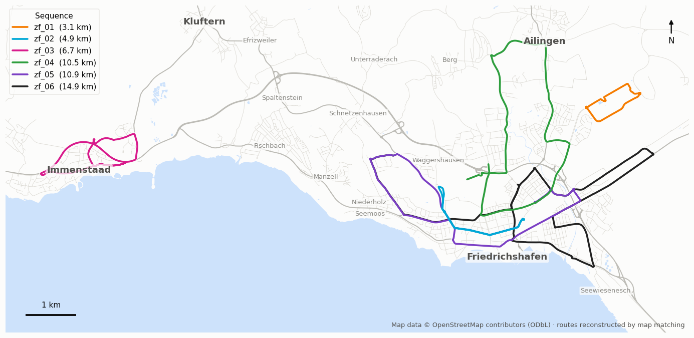
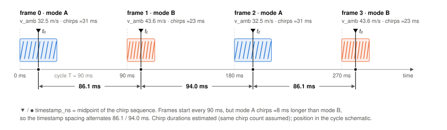
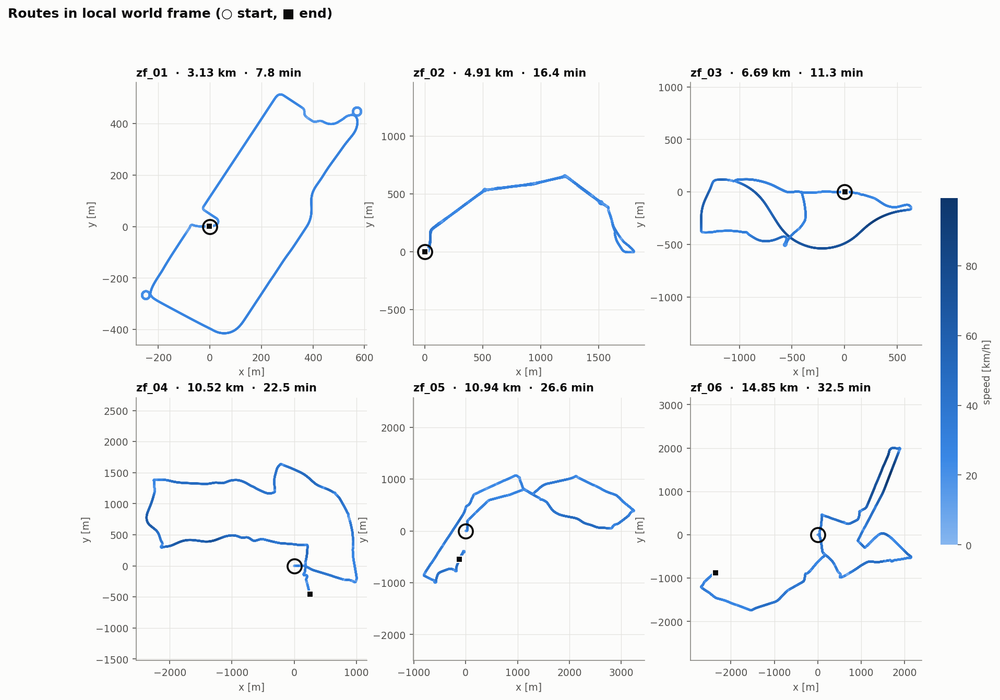

# ZF FRGen21 Automotive Radar Dataset

Automotive radar point clouds with GNSS/INS ground-truth trajectories, recorded
with a ZF FRGen21 77 GHz imaging radar (front-center mounted) on public roads.
The dataset contains **6 sequences**, ~**78,000 radar frames**, ~**51 km** and
~**2 hours** of driving.


## Download

The complete dataset is permanently archived on Zenodo:

**[Download the ZF FRGen21 Automotive Radar Dataset](https://doi.org/10.5281/zenodo.21318976)**

The Zenodo record contains six sequence archives (`zf_01.zip` … `zf_06.zip`),
a shared `extrinsics.csv`, and the complete dataset documentation.

## Getting started

1. Download and unzip each sequence archive into a common directory.
2. Place the shared `extrinsics.csv` at the root of that directory.
3. Install this repository and optionally launch the visualizer:

```bash
git clone https://github.com/kyleretan/zf-frgen21-automotive-radar-dataset.git
cd zf-frgen21-automotive-radar-dataset
pip install ".[viz]"
zf-radar-viz -p /path/to/ZF_Dataset
```

## Sequences

| Sequence | Frames | Duration | Distance |
|----------|-------:|---------:|---------:|
| zf_01    |  5,205 |  7.8 min |  3.1 km  |
| zf_02    | 10,914 | 16.4 min |  4.9 km  |
| zf_03    |  7,548 | 11.3 min |  6.7 km  |
| zf_04    | 14,971 | 22.5 min | 10.5 km  |
| zf_05    | 17,717 | 26.6 min | 10.9 km  |
| zf_06    | 21,643 | 32.5 min | 14.9 km  |

## Directory layout

```
ZF_Dataset/
├── extrinsics.csv          # sensor-to-vehicle extrinsics (shared by all sequences)
├── zf_01/
│   ├── ground_truth.csv    # vehicle pose + velocity, one row per radar frame
│   └── radar/
│       ├── frame_000000.pcd
│       ├── frame_000001.pcd
│       └── ...
├── zf_02/
└── ...
```

## Coordinate conventions

- **Sensor frame (SCS):** x forward, y left, z up (right-handed).
  Azimuth is positive to the **left** (`azimuth = atan2(y, x)`), elevation
  positive **up** (`elevation = arcsin(z / range)`).
- **Vehicle frame:** origin at the **center of the rear axle** (GNSS/INS
  reference point), axes aligned with the sensor frame convention.
- **World frame:** the origin and axes coincide with the vehicle frame at the
  first retained radar frame of each sequence. Consequently, the first
  vehicle-to-world pose is the identity.

## Radar frames (`radar/frame_XXXXXX.pcd`)

ASCII PCD v0.7 files, one per retained radar scan (~11.1 Hz average frame rate
over the published sequences). Two metadata lines precede the standard PCD
header:

```
# .PCD v0.7 - Point Cloud Data file format
# timestamp_ns 1624006954674470229
# velocity_ambiguity 32.499187
...
FIELDS x y z range azimuth elevation velocity rcs power snr
...
DATA ascii
```

| Metadata | Description |
|----------|-------------|
| `timestamp_ns` | Midpoint of the radar chirp sequence, expressed as nanoseconds since the Unix epoch (`1970-01-01 00:00:00 UTC`) and derived from the GPS-synchronized OxTS time base |
| `velocity_ambiguity` | Width of the unambiguous Doppler interval in m/s (see below) |

| Field | Unit | Description |
|-------|------|-------------|
| `x`, `y`, `z` | m | Cartesian position in the sensor frame (derived from range/azimuth/elevation) |
| `range` | m | Radial distance |
| `azimuth` | rad | Horizontal angle, positive left |
| `elevation` | rad | Vertical angle, positive up |
| `velocity` | m/s | Radial (Doppler) velocity, **negative = approaching** |
| `rcs` | dBsm | Radar cross-section |
| `power` | – | Received power (linear, arbitrary units) |
| `snr` | dB | Signal-to-noise ratio |

**Doppler ambiguity.** Measured radial velocities wrap into the interval
±`velocity_ambiguity`/2. The sensor alternates between two scan modes on
consecutive frames with different ambiguity ranges (≈32.5 and ≈43.6 m/s),
so the unambiguous interval changes frame to frame — always read it from the
frame header. Observed field of view is roughly ±50° azimuth, ±15° elevation,
with detections out to ~100 m.

**Manufacturer specifications.** The manufacturer specifies nominal accuracies
of 0.15° in azimuth, 0.3° in elevation, 0.01 m/s in radial velocity, and 0.02 m
in range, depending on target properties and sensor mode. These values were not
estimated from this dataset and should not be interpreted as measurement-noise
standard deviations.

> ⚠️ **Generic PCD readers (Open3D, PCL) return only `x`/`y`/`z`** and
> silently drop the radar fields (`velocity`, `snr`, …) and the comment-line
> metadata — including `velocity_ambiguity`, without which wrapped Doppler
> velocities cannot be interpreted. Use a header-aware reader:

```python
import numpy as np

def load_radar_pcd(path):
    meta, fields, n, skip = {}, [], 0, 0
    with open(path) as f:
        for line in f:
            skip += 1
            if line.startswith("# ") and len(line.split()) == 3:
                key, val = line.split()[1:]
                meta[key] = int(val) if val.isdigit() else float(val)
            elif line.startswith("FIELDS"):
                fields = line.split()[1:]
            elif line.startswith("POINTS"):
                n = int(line.split()[1])
            elif line.startswith("DATA"):
                break
    data = np.loadtxt(path, skiprows=skip, max_rows=n, ndmin=2)
    return {f: data[:, i] for i, f in enumerate(fields)}, meta

points, meta = load_radar_pcd("zf_01/radar/frame_000000.pcd")
v_amb = meta["velocity_ambiguity"]   # Doppler wraps into ±v_amb/2
doppler = points["velocity"]         # m/s, negative = approaching
```

This repo ships the same reader (plus pose/extrinsics/sequence helpers) as a
numpy-only package — `pip install .` then `from zf_radar import load_pcd,
load_poses, load_extrinsics, discover_sequences`.

## Ground truth (`ground_truth.csv`)

GNSS/INS (OxTS) ground truth supplied at the radar frame timestamps. The OxTS
system was configured to provide the vehicle pose at the center of the rear
axle. The published poses are supplied directly at this reference point rather
than being transformed there during dataset post-processing. The trajectories
were generated using combined forward–backward OxTS processing. This processing
changes the estimated navigation solution but not the associated timestamps.
The first line of the file is a **header row** (`t,T00,…,wz`); every line
after it is **one data row per radar frame**, so data row *i* corresponds to
`frame_%06i.pcd` (the file has exactly `num_frames + 1` lines). KITTI-style
format, 19 comma-separated columns:

| Columns | Description |
|---------|-------------|
| `t` | Frame timestamp in seconds, relative to the sequence start |
| `T00 … T23` | Vehicle-to-world pose: 3×4 transform <code>[R &#124; t]</code>, row-major |
| `vx, vy, vz` | Linear velocity in the **vehicle body frame**, m/s |
| `wx, wy, wz` | Angular velocity in the vehicle body frame, rad/s |

For each sequence, `t` is obtained from the corresponding radar-frame
timestamp as

```text
t[i] = (timestamp_ns[i] - timestamp_ns[0]) * 1e-9
```

```python
import numpy as np

data = np.loadtxt("zf_01/ground_truth.csv", delimiter=",", skiprows=1)
T = np.zeros((len(data), 4, 4))
T[:, :3, :4] = data[:, 1:13].reshape(-1, 3, 4)
T[:, 3, 3] = 1.0                      # (N, 4, 4) vehicle -> world
v_body, w_body = data[:, 13:16], data[:, 16:19]
```

## Extrinsics (`extrinsics.csv`)

Sensor-to-vehicle transform in the same 3×4 row-major format (`T00 … T23`),
shared by all sequences. Like the ground truth, the file has a header row
followed by a single data row. The radar is mounted **3.925 m ahead of the rear
axle** at the front bumper. The transform maps a point from the **sensor frame
into the vehicle frame** (`p_vehicle = T_sensor_vehicle @ p_sensor`). Its
rotational component is the nominal identity, corresponding to an assumed
alignment between the radar and vehicle axes; it was not independently
estimated. To project a radar point `p` (sensor frame) into the world frame of
frame `i`:

```python
p_world = T[i] @ T_sensor_vehicle @ [x, y, z, 1]
```

## Visualizer

An interactive Qt viewer (`visualizer.py`) shows the point cloud in the world
frame alongside an azimuth–Doppler plot with the per-frame ambiguity bounds.

```bash
# from a checkout:
pip install -r requirements.txt   # numpy, PyQt6, pyqtgraph, PyOpenGL
python visualizer.py -p /path/to/ZF_Dataset

# or installed as a package (the [viz] extra pulls in the GUI stack):
pip install ".[viz]"
zf-radar-viz -p /path/to/ZF_Dataset
```

| Control | Action |
|---------|--------|
| `Seq` dropdown | Switch sequence |
| Play / `Space` | Toggle playback |
| `←` / `→` | Step one frame |
| Slider | Scrub through the sequence |
| `Color` dropdown | Color points by SNR or RCS |
| Mouse drag / wheel | Orbit / zoom the 3D view |
| `Ctrl+C` (terminal) | Quit |

The 3D view shows the ground-truth trajectory (solid = traversed, faded =
upcoming), the rear-axle and sensor positions, and the ego-vehicle outline.
The azimuth–Doppler plot uses a driver's-eye orientation (targets to the
right of the vehicle appear on the right).

## Fork additions

Tools and observations added in this fork. Everything above is the original
dataset documentation, unchanged.

### Sequence statistics and routes

| Sequence | Speed mean / max | Height range | Standstill | Detections / frame | Doppler-wrapped frames |
|----------|-----------------:|-------------:|-----------:|-------------------:|-----------------------:|
| zf_01    | 24 / 32 km/h     |  18 m        |  2.0 %     | 703                | 0.0 %                  |
| zf_02    | 18 / 46 km/h     |  74 m        | 24.1 %     | 422                | 0.0 %                  |
| zf_03    | 36 / 92 km/h     |  21 m        |  1.2 %     | 637                | 8.3 %                  |
| zf_04    | 28 / 72 km/h     | 127 m        | 18.7 %     | 549                | 1.8 %                  |
| zf_05    | 25 / 51 km/h     | 132 m        | 13.6 %     | 555                | 0.0 %                  |
| zf_06    | 27 / 99 km/h     | 101 m        | 17.8 %     | 528                | 4.1 %                  |

Standstill = ego speed below 0.3 m/s; the radar then reports only ~40 detections
per frame. Doppler-wrapped = ego speed above `velocity_ambiguity / 2`.



`zf_02`/`zf_05` and `zf_05`/`zf_06` share roads, which makes them useful for
cross-sequence localization and loop closure.

### Notes on the data

Measured from the published files; not part of the official documentation.

- **Frame timing.** Frames run on a fixed 90 ms cycle and the two scan modes
  alternate strictly. `timestamp_ns` marks the middle of the chirp sequence, and
  the low-ambiguity mode chirps ≈8 ms longer, so consecutive timestamps
  alternate 86.1 / 94.0 ms. The sensor clock is re-synchronised about every
  15 s (sawtooth of ±0.9 ms), and `zf_05` skips 7 cycles. Always use the
  per-frame `timestamp_ns`. Details: `python scripts/analyze_timing.py -p <dataset>`.

  

- **`zf_05` uses a different chirp configuration**: `velocity_ambiguity`
  31.97 / 42.63 m/s instead of 32.50 / 43.57 m/s.
- **Ground truth: positions on the UTM grid, orientation to true north.** The
  positions in `ground_truth.csv` were apparently computed in UTM (zone 32N),
  while orientation and velocities come from the INS relative to true north.
  Hence on straight roads the GT heading is 0.2–0.4° off the direction of the GT
  positions (UTM meridian convergence), and distances are ~0.045 % short (UTM
  scale). For odometry evaluation this adds ~0.3 % to the KITTI translation
  error of any method; rotating the GT orientation by one constant per sequence
  (path direction vs. heading on straights, estimable from the GT alone) removes it.
- **Radar yaw mounting.** The extrinsic rotation is the nominal identity. The
  data indicate a radar yaw offset of about 0.1° (0.05–0.17°, varying between
  recording days). With the 3.9 m lever arm this biases any Doppler-based yaw
  rate by roughly 2.5°/100 m.

### Tools

**Loader.** Besides the functions above: `load_pcd_meta(path)` reads only the
PCD header (timestamp, `velocity_ambiguity`, point count), and
`load_ground_truth(seq_dir)` returns time, poses and body-frame velocities.

**Route plots and statistics** (`pip install ".[plot]"`):

```bash
zf-radar-plot -p /path/to/ZF_Dataset -o plots/
```

Writes the overview below, one profile per sequence (speed, height, yaw rate,
detections over time) and `summary.csv`. Routes are in each sequence's own
world frame; the swatch is the sequence's color in the map.



**Doppler de-aliasing.** `zf_radar.doppler` recovers the unwrapped radial
velocities from the radar data alone. Static points are unwrapped with an ego
velocity estimated per frame from the Doppler; moving points by matching them
to nearby points of the neighbouring frame, which uses the other scan mode, and
then per object, tracked over time. Checked against the ground truth: ≥ 99.9 % of
wrapped static points are correct, the ego velocity is within a few cm/s;
3–4 % of points (mostly isolated clutter) stay unresolved and are flagged.
Runs at ~6 ms per frame (`scripts/eval_doppler_unwrap.py`; moving targets have no
ground truth, `scripts/eval_moving_consistency.py` checks them for frame-to-frame
flicker).

```python
from zf_radar import load_pcd
from zf_radar.doppler import unwrap_sequence
for frame, res in unwrap_sequence(load_pcd(p) for p in pcd_paths):
    res["velocity_unwrapped"], res["unwrap_status"], res["sensor_velocity"]
```

**ROS 2 MCAP export** (`pip install ".[mcap]"`, no ROS needed):

```bash
zf-radar-mcap -p /path/to/ZF_Dataset -o mcap/ [--unwrap-doppler]
```

One file per sequence; opens in [Foxglove](https://foxglove.dev), plays with
`ros2 bag play -s mcap mcap/zf_01.mcap`. All messages carry the radar frame's
`timestamp_ns`.

| Topic | Type | Content |
|-------|------|---------|
| `/radar/points` | `sensor_msgs/PointCloud2` | all PCD fields, frame `radar`; with `--unwrap-doppler` also `velocity_unwrapped`, `wrap_k`, `unwrap_status` |
| `/radar/velocity_ambiguity` | `std_msgs/Float32` | Doppler interval of the frame [m/s] |
| `/radar/ego_velocity` | `geometry_msgs/TwistStamped` | radar-only ego velocity (with `--unwrap-doppler`) |
| `/ground_truth/odom`, `/ground_truth/path` | `nav_msgs` | ground truth, `odom_ins` → `base_link` |
| `/tf`, `/tf_static` | `tf2_msgs/TFMessage` | `odom_ins` → `base_link` → `radar` |

`base_link` is the rear axle; `odom_ins` is the dataset's world frame (the vehicle
pose at the first frame, [REP-105](https://www.ros.org/reps/rep-0105.html) naming).
If you have georeferenced start poses, `--georef poses.json` (`pip install ".[geo]"`)
adds `map → odom_ins` and `/gnss/fix`; the expected file format is described in
`zf_radar/georef.py`. No such poses are included in this repository.

## License

The loader and visualization software in this repository is released under the
[MIT License](LICENSE).

The associated dataset is released separately under the
[Creative Commons Attribution 4.0 International
License](https://creativecommons.org/licenses/by/4.0/).

## Citation

Please cite the archived dataset using the citation provided by Zenodo:

```bibtex
@dataset{retan_2026_zf_frgen21,
  author    = {Retan, Kyle and Loshaj, Frasher and Heizmann, Michael},
  title     = {{ZF FRGen21 Automotive Radar Dataset}},
  year      = {2026},
  publisher = {Zenodo},
  version   = {v1.0.0},
  doi       = {10.5281/zenodo.21318976},
  url       = {https://doi.org/10.5281/zenodo.21318976}
}
```

An associated manuscript describes the dataset and its use for radar odometry.
Article citation details will be added after publication.